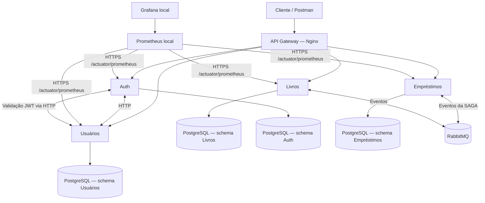

# Biblioteca — Microsserviços e DevOps (UDESC)

Sistema acadêmico de gerenciamento de biblioteca desenvolvido com arquitetura de microsserviços. O projeto demonstra integração síncrona por HTTP, comunicação assíncrona por RabbitMQ, orquestração de empréstimos com o padrão **SAGA**, conteinerização, integração e entrega contínuas (CI/CD), ambientes **DEV** e **HOMOL**, e observabilidade com **Prometheus** e **Grafana**.

> **Projeto acadêmico.** Os ambientes públicos utilizam serviços gratuitos do Render e podem demorar a responder após períodos de inatividade. O Prometheus e o Grafana são executados localmente, mas consultam as métricas publicadas pelos microsserviços nos dois ambientes. A disponibilidade dos endpoints depende do estado dos serviços e das configurações vigentes.

## 1. Tecnologias

| Camada | Tecnologias |
| --- | --- |
| Microsserviços | Java 21, Spring Boot, Maven, Spring Data JPA |
| API Gateway | Nginx |
| Persistência | PostgreSQL 16; um banco por serviço no Docker Compose local e schemas segregados na hospedagem |
| Mensageria | RabbitMQ (Docker Compose local / CloudAMQP na nuvem) |
| Documentação das APIs | Springdoc / OpenAPI / Swagger UI |
| Testes e qualidade | Maven, JUnit, JaCoCo, SonarQube Cloud |
| CI/CD e imagens | GitHub Actions, Docker, GitHub Container Registry (GHCR), Render Deploy Hooks |
| Monitoramento | Spring Boot Actuator, Micrometer, Prometheus, Grafana |

## 2. Arquitetura



### Responsabilidades

- **Auth:** cadastro/autenticação, emissão e validação de tokens JWT; integração com Usuários.
- **Usuários:** dados cadastrais de usuários; validação de tokens via Auth quando aplicável.
- **Livros:** cadastro, consulta e controle do acervo/estoque.
- **Empréstimos:** solicitação, consulta de status e devolução; coordenação da SAGA.
- **API Gateway:** ponto de entrada único e encaminhamento das rotas HTTP.

### SAGA de empréstimo

A solicitação `POST /emprestimos` inicia uma operação assíncrona, que recebe um identificador `sagaId`. O status pode ser consultado em `GET /emprestimos/{sagaId}`. Entre os estados previstos estão `INICIADA`, `LIVRO_RESERVADO`, `USUARIO_VALIDADO`, `CONCLUIDA` e os estados de falha/compensação. O RabbitMQ transporta eventos usados na coordenação da operação. O fluxo foi testado no ambiente DEV.

> O retorno `202 Accepted` confirma o recebimento da solicitação, **não** a conclusão da SAGA. Consulte o status até o estado terminal para confirmar o resultado.

## 3. Estrutura do repositório

```text
.
├── .github/workflows/       # CI/CD por serviço
├── api-gateway/             # Nginx e template de roteamento
├── auth/                    # Microsserviço de autenticação
├── usuarios/                # Microsserviço de usuários
├── livros/                  # Microsserviço de livros
├── emprestimos/             # Microsserviço de empréstimos / SAGA
├── monitoring/              # Docker Compose do Prometheus/Grafana
├── docker-compose.yml       # Stack de desenvolvimento local
├── .env.example             # Modelo de variáveis locais
└── README.md
```

## 4. Execução local com Docker Compose

**Pré-requisitos:** Docker com Compose; Git. Para executar serviços fora do Docker, Java 21 e Maven.

```bash
git clone https://github.com/Myllenam/devops-udesc.git
cd devops-udesc
cp .env.example .env
```

Preencha o `.env` local com os valores exigidos pelo Compose (`*_DB_PASSWORD`, `RABBITMQ_USER`, `RABBITMQ_PASSWORD`, `JWT_SECRET` etc.). **Não versione nem compartilhe as credenciais.**

```bash
docker compose up -d --build
docker compose ps
```

O Gateway local utiliza, por padrão, a porta HTTP **80**, se estiver disponível no computador:

```bash
curl -i http://localhost/livros
```

Os serviços usam os nomes Docker (`auth`, `usuarios`, `livros`, `emprestimos`) na comunicação interna. As variáveis do Compose devem apontar para esses nomes, não para as URLs do Render. Para encerrar:

```bash
docker compose down
```

Use `docker compose down -v` **somente** se quiser apagar os volumes e dados locais.

## 5. Ambientes na nuvem

Os Web Services são publicados individualmente no Render, com imagens Docker disponibilizadas pelo GHCR. Em hospedagem, o PostgreSQL é compartilhado por limitação do plano gratuito, com **um schema por microsserviço e ambiente**.

| Componente | DEV | HOMOL |
| --- | --- | --- |
| API Gateway | https://biblioteca-gateway-dev.onrender.com | https://biblioteca-gateway-homol.onrender.com |
| Auth | https://biblioteca-auth-dev.onrender.com | https://biblioteca-auth-homol.onrender.com |
| Usuários | https://biblioteca-usuarios-dev.onrender.com | https://biblioteca-usuarios-homol.onrender.com |
| Livros | https://biblioteca-livros-dev.onrender.com | https://biblioteca-livros-homol.onrender.com |
| Empréstimos | https://biblioteca-emprestimos-dev.onrender.com | https://biblioteca-emprestimos-homol.onrender.com |

**Configurações por ambiente:**

| Item | DEV | HOMOL |
| --- | --- | --- |
| Branch | `develop` | `main` |
| Tag GHCR | `:develop` | `:main` |
| Spring profile | `dev` | `homol` |
| Swagger UI / OpenAPI | Habilitados | Desabilitados |
| Schemas PostgreSQL | `dev_auth`, `dev_usuarios`, `dev_livros`, `dev_emprestimos` | `homol_auth`, `homol_usuarios`, `homol_livros`, `homol_emprestimos` |
| URLs de integração | Endpoints `-dev` | Endpoints `-homol` |

### Variáveis no Render

Os serviços Spring Boot usam, conforme suas dependências:

- `SPRING_PROFILES_ACTIVE`
- `SPRING_DATASOURCE_URL`, `SPRING_DATASOURCE_USERNAME`, `SPRING_DATASOURCE_PASSWORD`
- `SPRING_DATASOURCE_HIKARI_SCHEMA`, `SPRING_JPA_PROPERTIES_HIBERNATE_DEFAULT_SCHEMA`
- `AUTH_SERVICE_URL` (em serviços que validam tokens no Auth)
- `USUARIOS_SERVICE_URL` (no Auth, para comunicação com Usuários)
- `SPRING_RABBITMQ_ADDRESSES` (em serviços que utilizam o broker)
- `METRICS_TOKEN` (quando o endpoint de métricas possuir proteção por token)

O Nginx recebe `PORT`, `AUTH_URL`, `USUARIOS_URL`, `LIVROS_URL` e `EMPRESTIMOS_URL`. Em Render, as URLs devem usar **HTTPS** e apontar para o mesmo ambiente.

> **Isolamento de mensageria:** os ambientes podem compartilhar uma instância CloudAMQP, mas as filas/exchanges e os consumidores devem ser separados por ambiente antes de executar operações de SAGA simultâneas em DEV e HOMOL. Não considerar o isolamento validado sem testar as configurações efetivas.

### Swagger

Em DEV, por exemplo:

- Auth: https://biblioteca-auth-dev.onrender.com/swagger-ui/index.html
- Documentação OpenAPI: `GET https://biblioteca-auth-dev.onrender.com/v3/api-docs`

Em HOMOL, os endpoints de documentação devem estar desabilitados (por exemplo, `/v3/api-docs` deve retornar `404`), enquanto os endpoints funcionais permanecem disponíveis.

## 6. API: teste rápido

Defina como base no Postman:

```text
{{baseUrl}} = https://biblioteca-gateway-dev.onrender.com
```

| Método | Rota | Finalidade |
| --- | --- | --- |
| POST | `/auth/register` | Cadastrar usuário |
| POST | `/auth/login` | Obter JWT |
| POST | `/auth/validate` | Validar JWT |
| GET | `/livros` | Consultar livros |
| POST | `/emprestimos` | Iniciar SAGA de empréstimo |
| GET | `/emprestimos/{sagaId}` | Consultar estado da SAGA |
| PATCH | `/emprestimos/{id}/devolucao` | Registrar devolução |
| GET | `/emprestimos/usuario/{usuarioId}` | Consultar empréstimos do usuário |
| GET | `/emprestimos/quantidade` | Consultar quantidade total |

Para rotas autenticadas, envie `Authorization: Bearer <JWT>`. O JWT é obtido após `POST /auth/login`. O corpo da solicitação de empréstimo contém IDs válidos, por exemplo:

```json
{
  "livroId": 1,
  "usuarioId": 1
}
```

**Roteiro de demonstração:** cadastrar usuário, autenticar, cadastrar/consultar um livro disponível, iniciar empréstimo, registrar o `sagaId`, consultar seu status e conferir os efeitos esperados da SAGA. Os identificadores acima são ilustrativos.

## 7. Git Flow e CI/CD

A estratégia de branches é:

```text
feature/*  → Pull Request → develop (DEV)
                                  ↓
                              Pull Request
                                  ↓
                               main (HOMOL)
```

Os pipelines independentes ficam em `.github/workflows/` e acompanham os componentes (`ci-auth.yml`, `ci-usuarios.yml`, `ci-livros.yml`, `ci-emprestimos.yml`, `ci-gateway.yml`). O fluxo implementado inclui:

1. Execução mediante alteração nos caminhos do serviço ou do próprio workflow.
2. Checkout, configuração do JDK 21 (serviços Java), build e testes Maven.
3. Geração/verificação de relatório JaCoCo nos pipelines configurados.
4. Análise do SonarQube Cloud nas condições definidas pelo workflow (especialmente `main` e PR para `main`).
5. Construção e publicação de imagens no GHCR somente após o sucesso da validação.
6. Acionamento de **Deploy Hook** específico do Render, conforme a branch e o serviço.

**Regras de deploy:**

- `push` em `develop` → imagem `:develop` → serviço `biblioteca-<componente>-dev`.
- `push` em `main` → imagem `:main` → serviço `biblioteca-<componente>-homol`.
- O serviço correspondente é atualizado de forma independente; os demais não precisam ser reconstruídos pela mesma alteração.

As imagens seguem o padrão:

```text
ghcr.io/myllenam/devops-udesc-auth:develop
ghcr.io/myllenam/devops-udesc-usuarios:develop
ghcr.io/myllenam/devops-udesc-livros:develop
ghcr.io/myllenam/devops-udesc-emprestimos:develop
ghcr.io/myllenam/devops-udesc-api-gateway:develop
```

Para HOMOL, use `:main`. Também são publicadas tags relacionadas ao SHA do commit.

**Segredos de CI/CD:** os Deploy Hooks e tokens de serviços externos ficam em **GitHub Actions Secrets**, nunca no repositório. Os hooks seguem a convenção `RENDER_DEPLOY_HOOK_<SERVICO>_DEV` e `RENDER_DEPLOY_HOOK_<SERVICO>_HOMOL`.

- [GitHub Actions](https://github.com/Myllenam/devops-udesc/actions)
- [Packages / GHCR](https://github.com/Myllenam?tab=packages)
- [SonarQube Cloud](https://sonarcloud.io/)

## 8. Monitoramento: Prometheus e Grafana

O **Prometheus** e o **Grafana** são iniciados no computador do avaliador, mas as fontes de métricas são os serviços publicados no Render. O Prometheus consulta os endpoints HTTPS `/actuator/prometheus` de DEV e HOMOL e o Grafana apresenta dashboards com dados coletados.

### Inicialização

Crie o arquivo `monitoring/.env` (não versionado):

```dotenv
GRAFANA_ADMIN_PASSWORD=defina_uma_senha_local
```

Se os endpoints de métricas estiverem protegidos por token, crie `monitoring/prometheus/secrets/metrics_token` com **somente o token**, sem prefixo `Bearer`, e mantenha esse diretório no `.gitignore`. O token deve corresponder ao configurado nos serviços Render. A configuração de coleta encontra-se em `monitoring/prometheus/prometheus.yml`.

```bash
docker compose -f monitoring/docker-compose.yml up -d
```

| Ferramenta | URL local | Uso |
| --- | --- | --- |
| Prometheus | http://localhost:9090 | Consultas PromQL |
| Targets | http://localhost:9090/targets | Verificar serviços `UP` / `DOWN` |
| Grafana | http://localhost:3000 | Dashboards (usuário local padrão: `admin`) |

No Grafana, configure a fonte de dados **Prometheus** com a URL **`http://prometheus:9090`** (endereço entre os containers, não `localhost:9090`).

### Consultas PromQL para demonstração

**Disponibilidade por ambiente:**

```promql
up{job=~"biblioteca-dev|biblioteca-homol"}
```

**Memória heap por serviço:**

```promql
sum by (ambiente, instance) (jvm_memory_used_bytes{area="heap"})
```

**Uso de CPU do processo Java (percentual):**

```promql
process_cpu_usage{job=~"biblioteca-dev|biblioteca-homol"} * 100
```

**Threads JVM:**

```promql
jvm_threads_live_threads{job=~"biblioteca-dev|biblioteca-homol"}
```

Os gráficos podem ser construídos no Grafana ou adaptados a partir de dashboards JVM/Micrometer. Os filtros `job`, `instance` e `ambiente` refletem as labels configuradas no Prometheus.

### Observações sobre o monitoramento

- O status `UP` do Prometheus confirma o sucesso da coleta, **não** a saúde completa das operações de negócio.
- Alguns serviços gratuitos do Render podem suspender por inatividade e demorar a iniciar; durante esse período podem surgir timeouts, falhas `502` ou targets `DOWN`.
- Consultas frequentes do Prometheus podem manter serviços ativos e consumir a franquia gratuita do Render. Execute a coleta somente durante testes/demonstrações quando apropriado.
- O acesso a `/actuator/prometheus` deve ser protegido em sistemas reais. A implementação acadêmica pode ter proteção desigual entre os microsserviços; não considerar todos os endpoints seguros sem testar `401` sem token e `200` com token.

Para encerrar a infraestrutura local de monitoramento:

```bash
docker compose -f monitoring/docker-compose.yml stop
```

## 9. Verificações e evidências de entrega

Checklist recomendado para a demonstração:

- [ ] Pipeline de CI e publicação no GHCR concluído para cada componente.
- [ ] Deploy automático DEV após alteração em `develop` demonstrado.
- [ ] Deploy automático HOMOL após alteração em `main` demonstrado.
- [ ] Gateway DEV e HOMOL encaminhando chamadas aos microsserviços.
- [ ] PostgreSQL com schemas distintos por ambiente/serviço.
- [ ] Swagger disponível em DEV e indisponível em HOMOL.
- [ ] Fluxo da SAGA até um estado final demonstrado, incluindo mensagens do RabbitMQ.
- [ ] Isolamento das filas de DEV e HOMOL verificado antes de testes concorrentes.
- [ ] Prometheus mostrando os targets dos dois ambientes.
- [ ] Grafana exibindo gráficos de JVM e disponibilidade dos serviços.

### Comandos úteis

```bash
# Gateway DEV
curl -i https://biblioteca-gateway-dev.onrender.com/livros

# Swagger DEV (exemplo Auth)
curl -i https://biblioteca-auth-dev.onrender.com/v3/api-docs

# Swagger HOMOL — resultado esperado: 404
curl -i https://biblioteca-auth-homol.onrender.com/v3/api-docs

# Listar tabelas de DEV e HOMOL via psql, após conectar ao PostgreSQL
# SELECT table_schema, table_name FROM information_schema.tables
# WHERE table_schema LIKE 'dev_%' OR table_schema LIKE 'homol_%'
# ORDER BY table_schema, table_name;
```

## 10. Limitações conhecidas

- **Render Free:** serviços podem suspender após inatividade, causando inicialização demorada; um `502` isolado não prova erro de aplicação.
- **PostgreSQL gratuito:** uso de um banco compartilhado e schemas, em vez de instâncias de banco independentes na nuvem.
- **Mensageria compartilhada:** DEV e HOMOL exigem isolamento efetivo de filas/exchanges para evitar interferência.
- **Monitoramento local:** Prometheus e Grafana não ficam permanentemente disponíveis quando o computador está desligado.
- **Credenciais e métricas:** valores de tokens e senhas não são versionados; endpoints Actuator públicos são inadequados para produção.

## 11. Repositório

Código-fonte e workflows: https://github.com/Myllenam/devops-udesc

Projeto desenvolvido para a disciplina de DevOps da UDESC.
